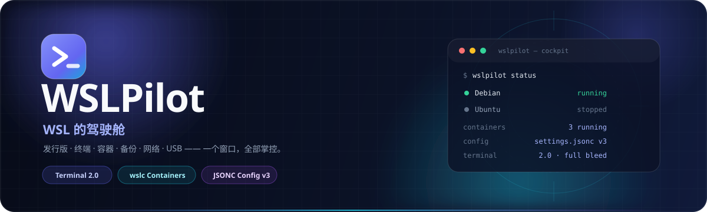
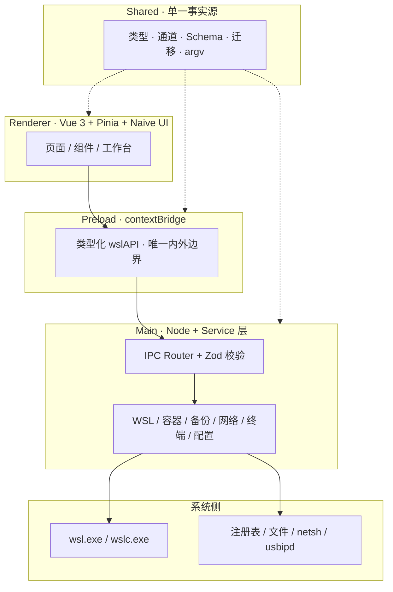

<div align="center">
  

  <h1>WSLPilot</h1>

  <p><strong>WSL 的驾驶舱。</strong>像开飞机一样管理你的 Linux 发行版：一眼看清全局，一键完成操作，一切尽在掌握。</p>

  <p>
    <a href="https://github.com/ThzxxArt/WSLPilot/actions/workflows/ci.yml"></a>
    <a href="https://github.com/ThzxxArt/WSLPilot"></a>
    <a href="./LICENSE"></a>
    <a href="https://github.com/ThzxxArt/WSLPilot"></a>
    <a href="https://github.com/ThzxxArt/WSLPilot"></a>
  </p>

  <p>
    <a href="https://github.com/ThzxxArt/WSLPilot"></a>
    <a href="https://github.com/ThzxxArt/WSLPilot"></a>
    <a href="https://github.com/ThzxxArt/WSLPilot"></a>
    <a href="https://github.com/ThzxxArt/WSLPilot"></a>
    <a href="https://github.com/ThzxxArt/WSLPilot"></a>
  </p>

  <p>
    <a href="https://github.com/ThzxxArt/WSLPilot"></a>
    <a href="https://github.com/ThzxxArt/WSLPilot"></a>
    <a href="https://github.com/ThzxxArt/WSLPilot"></a>
  </p>

  <p>
    <a href="#features">功能总览</a> ·
    <a href="#terminal">终端 2.0</a> ·
    <a href="#containers">容器工作台</a> ·
    <a href="#quickstart">快速开始</a> ·
    <a href="#quality">质量门禁</a> ·
    <a href="#architecture">架构</a>
  </p>
</div>

---

## ✨ 为什么是 WSLPilot

WSLPilot 不是另一个终端模拟器，而是把 WSL 从「命令行里的若干发行版」变成**可视、可恢复、可审计的工作台**。

| 🎛️ 一个窗口，全部掌控                                                          | 🧠 真实数据，不做假进度                                                                | 🛡️ 破坏性操作可恢复                                                    |
| :----------------------------------------------------------------------------- | :------------------------------------------------------------------------------------- | :--------------------------------------------------------------------- |
| 发行版、终端、容器、备份、网络、USB 设备与配置文件，全部收进一个原生桌面应用。 | CPU `/proc/stat` 双采样、磁盘真实占用、容器 `stats` 原值；不推算、不伪造、不表演进度。 | 长任务可取消、失败自动回滚、操作前等价命令预览、配置原子写与自动备份。 |

---

<a id="features"></a>

## 🚀 功能总览

| 模块                   | 你能得到什么                                                                                         |
| :--------------------- | :--------------------------------------------------------------------------------------------------- |
| 🐧 **发行版管理**      | 启动 / 停止 / 设为默认 / 全部关机；卡片与表格双视图；搜索、标签筛选、别名 / 品牌色 / 置顶 / 隐藏。   |
| 📊 **驾驶舱**          | 运行状态、内存 / 磁盘 / CPU 真实采样、容器指标、最近容器、快捷操作与安装引导。                       |
| 🖥️ **终端 2.0**        | 全出血工作台、多标签、分屏、专注模式、会话侧栏、Shell 集成、命令块、容器终端、Profile。              |
| 📦 **WSL 3 容器**      | 容器 / 镜像 / 网络 / 卷 / 系统五 Tab；运行向导、生命周期、日志、inspect、复制文件、`settings.yaml`。 |
| 💾 **备份迁移**        | tar / tar.gz / vhdx 导出，归档 / 就地导入，换盘迁移；进度、日志、取消、失败回滚、备份轮转。          |
| 🌐 **网络**            | `netsh` 端口转发规则、镜像网络模式引导、`.wslconfig` 可视化编辑、Windows / Linux 代理配置。          |
| 🔌 **USB 设备**        | `usbipd` 设备表、绑定 / 附加、目标发行版选择，未安装时给出安装引导。                                 |
| 🛠️ **wsl.conf / 动作** | 最小编辑保留注释、Diff 预览、冲突三选一；`actions.jsonc` 白名单动作与终端 / 无头执行。               |
| 📁 **文件浏览**        | 发行版内文件浏览与在线编辑，二进制识别、超限截断、脏数据保护、资源管理器定位。                       |
| ⚙️ **全局能力**        | 命令面板、全局快捷键、任务抽屉、提权助手、诊断包、签名状态、自动更新。                               |

<a id="terminal"></a>

### 🖥️ 终端 2.0

终端路由使用独立 `WorkbenchLayout`，不再渲染全局标题栏与状态栏；导航轨固定 **56px**，1920×1080 下绘图区占比 **≥90%**。

- **跨路由保活**：切换页面不销毁 xterm，vim / htop 现场与 scrollback 保留。
- **Shell 集成**：只写 `~/.wslpilot/shell-integration/`，绝不修改用户 rc；一键安装 / 修复 / 移除。
- **命令块**：解析 OSC `133` / `633` / `7`，展示退出码、耗时、cwd；右键复制上一条输出、重跑命令，`Alt+↑/↓` 跳转。
- **流控**：PTY 高水位 1MB 暂停、ACK 回落 256KB 恢复，大输出不压垮渲染层。
- **Profile**：`distro` / `container` / `command` 三类启动方式，主进程按 id 查配置构建 argv。
- **容器终端**：`wslc exec -it` 直接进入容器；容器默认 Shell 回退 `/bin/sh`，适配 alpine 等精简镜像。

<a id="containers"></a>

### 📦 WSL 3 容器工作台

独立探测 `wslc.exe`，旧版 WSL 只影响容器页并显示「更新 WSL」引导，不影响发行版管理。

| Tab      | 能力                                                                                                   |
| :------- | :----------------------------------------------------------------------------------------------------- |
| **容器** | 运行向导、等价 `wslc.exe` argv 预览、启停 / 重启 / 删除 / prune、inspect、日志流、文件复制、容器终端。 |
| **镜像** | 列表、拉取、构建（选择 Containerfile 目录）、删除、prune。                                             |
| **网络** | 列表、创建 / 删除 / connect / disconnect / prune；内置网络删除保护。                                   |
| **卷**   | 列表、创建 / 删除 / prune。                                                                            |
| **系统** | `system info`、会话列表、终止会话、`settings.yaml` 读写 / 重置、设置文件路径。                         |

所有 argv 由 `packages/shared/src/containers.ts` 结构化构建；容器名、镜像引用、挂载路径、端口、环境变量名、健康检查时长全部校验，拒绝注入、伪参数与路径逃逸。任务日志与 inspect 默认遮挡环境变量值。

---

## 🗺️ 页面导览

| 页面            | 一句话导览                                                              |
| :-------------- | :---------------------------------------------------------------------- |
| 🛫 **驾驶舱**   | 全局概览：指标卡、我的发行版、容器摘要、快捷操作、一键安装 / 全部关机。 |
| 🐧 **发行版**   | 列表与行内操作，搜索 / 标签筛选，卡片 ⇄ 表格切换，详情四标签。          |
| ⌨️ **终端**     | 全出血多标签工作台；分屏 / 专注 / 命令块 / 容器终端 / Shell 集成。      |
| 📦 **容器**     | WSL 3 容器 / 镜像 / 网络 / 卷 / 系统会话工作台。                        |
| 🌐 **网络**     | 镜像模式引导、端口转发规则表、代理配置、`.wslconfig` 全局编辑。         |
| 💾 **备份迁移** | 导出 / 导入 / 迁移三模式向导 + 最近备份列表。                           |
| 🔌 **USB 设备** | usbipd 设备管理，未安装时的安装引导。                                   |
| ⚙️ **设置**     | 外观、通用、WSL、终端、工作台、容器、备份、高级、快捷键、关于。         |

---

## ⌨️ 快捷键

全局快捷键在输入框与终端内会自动让位；终端专属组合只作用于终端。

| 快捷键                 | 功能                                                |
| :--------------------- | :-------------------------------------------------- |
| `Ctrl + K`             | 打开命令面板                                        |
| `Ctrl + N`             | 新建终端标签                                        |
| `Ctrl + Shift + T`     | 新建终端标签（终端内可用）                          |
| `Ctrl + Tab`           | 循环切换终端标签                                    |
| `Ctrl + Shift + 5`     | 终端左右分屏                                        |
| `Ctrl + Shift + 6`     | 终端上下分屏                                        |
| `Ctrl + 1…9`           | 切换终端标签                                        |
| `Ctrl + ,`             | 打开设置                                            |
| `Ctrl + R`             | 刷新发行版列表                                      |
| `Ctrl + Shift + P`     | 非终端页：显示 / 隐藏等价命令行；终端页：工具栏浮层 |
| `Alt + ↑ / ↓`          | 上一条 / 下一条命令块                               |
| `Ctrl + Shift + C / V` | 终端复制 / 粘贴                                     |
| `Ctrl + Shift + F`     | 终端搜索                                            |
| `Esc`                  | 退出终端专注模式                                    |

---

<a id="quickstart"></a>

## ⚡ 快速开始

### 环境要求

- **Windows 10 / 11**，已启用 WSL；WSL 2 推荐，容器工作台需要 WSL 3 / `wslc`
- **Node.js ≥ 22.22**、**npm ≥ 12**（`corepack enable` 可启用仓库钉定的 npm 版本）

### 从源码启动

```bash
corepack enable
npm ci          # 安装依赖；postinstall 自动生成设计令牌
npm run dev     # Electron + HMR
```

### 打包

```bash
npm run build                              # 构建并打包当前平台
npm run package --workspace @wslpilot/desktop -- --x64   # 指定 x64
```

也可以直接从 GitHub Releases 下载安装包。应用数据位于 `%APPDATA%\WSLPilot\`。

---

<a id="quality"></a>

## 🧪 质量与测试

```bash
npm test                 # 单元 / 集成测试
npm run test:coverage    # 覆盖率硬门禁
npm run test:component   # 组件测试 + 覆盖率硬门禁
npm run test:e2e         # Electron E2E + 视觉回归（需显示环境）
npm run test:visual      # 仅视觉回归
npm run smoke:product    # 产物模块图冒烟
npm run tokens:check     # 设计令牌漂移检查
```

| 指标            | 当前基线（0.2.2）                                                                                             |
| :-------------- | :------------------------------------------------------------------------------------------------------------ |
| 单元 / 集成测试 | **105 文件 / 1,532 用例**                                                                                     |
| 组件测试        | **24 文件 / 414 用例**                                                                                        |
| 单元覆盖率      | **Lines 96.16% · Branches 86.11% · Functions 94.00%**                                                         |
| 组件覆盖率      | **renderer Lines 79.62% · Branches 77.39% · Functions 75.55%**                                                |
| CI              | **Windows · Node 22 / 24 · lint / format / typecheck / coverage / component / build / smoke / E2E / package** |

- **零恒真断言**：测试必须观测真实行为，改坏实现必须变红。
- **E2E 隔离**：临时 `userData`（`WSLPILOT_USER_DATA`），不读写真实配置与日志。
- **视觉基线**：按平台入库（`linux` / `win32`），`updateSnapshots: 'none'`，缺基线直接失败。
- **E2E 串行**：应用是单实例语义，`workers: 1` 防止并行双开假红。

详细策略见 [docs/testing.md](./docs/testing.md)。

---

## 📦 构建、签名与自动更新

**代码签名（可选）**：设置 `CSC_LINK`（pfx 路径或 base64）与 `CSC_KEY_PASSWORD` 后打包自动签名。未签名构建首次运行可能触发 SmartScreen，点「更多信息 → 仍要运行」即可；签名状态可在「设置 → 关于」查看。

**发布校验**：

```bash
node scripts/verify-release.mjs --allow-unsigned --require-artifacts
```

校验版本一致性、CHANGELOG、tag、安装包 sha512、Authenticode 状态与 `verifyUpdateCodeSignature`。

> **当前发布状态**：仓库默认构建未配置证书，安装包为未签名；`app-update.yml` 没有 `publisherName`，因此即使 `verifyUpdateCodeSignature: true`，electron-updater 的发布者校验也不会真正生效。要获得发布者校验，必须配置签名证书并设置 `publisherName`。

**自动更新**：打包产物经 GitHub Releases 分发，`electron-updater` 读取 `app-update.yml` 检查与安装；可在「设置 → 高级」关闭自动检查。

---

## 🗂️ 配置文件

应用数据目录：`%APPDATA%\WSLPilot\`

| 文件               | 用途                                                                                 |
| :----------------- | :----------------------------------------------------------------------------------- |
| `settings.jsonc`   | 应用偏好（外观 / 通用 / 工作台 / 终端 / 容器 / WSL / 备份 / 高级）                   |
| `distros.jsonc`    | 发行版元数据（别名 / 图标 / 品牌色 / 置顶 / 快捷动作 / 默认 Shell / Profile / 隐藏） |
| `actions.jsonc`    | 自定义动作（执行白名单，带模板与占位符）                                             |
| `network.jsonc`    | 端口转发规则 / 代理配置                                                              |
| `containers.jsonc` | 容器运行配方与最近镜像（v1，不保存实时状态）                                         |
| `ui-state.jsonc`   | 界面状态（窗口位置 / 侧栏折叠 / 工作台布局 / 最近命令）                              |
| `state.jsonc`      | 运行态缓存（最近任务结果等）                                                         |
| `logs/`            | 按日滚动日志                                                                         |

所有配置均为**人类可读 JSONC**（允许注释与尾逗号），路径可见、内容可改、可纳入 Git。

- 写盘原子替换（临时文件 → fsync → rename），写前验证可解析。
- 外部修改由 chokidar 监听；冲突时三选一：**重载 / 覆盖 / 暂不处理**，未决期间拒绝写入。
- `$schemaVersion` + 迁移链，升级前自动备份。

完整字段见 [docs/config-reference.md](./docs/config-reference.md)。

---

<a id="architecture"></a>

## 🏗️ 架构



**核心原则**

- **单一系统入口**：副作用只出现在 Main / Service 层，渲染层零 Node。
- **契约先行**：通道、类型、Zod 入参与执行边界统一放在 `packages/shared`。
- **命令白名单 + 参数数组化**：禁止字符串拼接 shell 命令，容器 argv 由 shared 结构化构建。
- **失败可恢复**：长任务可取消、部分失败回滚、操作前等价命令预览、配置文件原子写。

详见 [docs/architecture.md](./docs/architecture.md)。

---

## 📁 工程结构

| 包 / 目录         | 职责                                                                     |
| :---------------- | :----------------------------------------------------------------------- |
| `packages/shared` | 类型、IPC 通道、Zod schema、错误码、设计令牌、配置迁移、容器 argv / 解析 |
| `packages/kit`    | 主进程工具（exec / 原子写 / JSONC / 日志 / 压缩 / 流式执行）             |
| `packages/ui`     | 设计令牌生成、Naive UI 主题、通用业务组件                                |
| `apps/desktop`    | Electron 主应用（main / preload / renderer）                             |
| `scripts`         | 设计令牌生成、产物冒烟、发布校验                                         |
| `docs`            | 架构 / 配置 / 设计系统 / 测试 / 0.2.0 方案                               |

---

## 🩺 故障排查

| 现象                                      | 处理                                                                                     |
| :---------------------------------------- | :--------------------------------------------------------------------------------------- |
| 首次运行提示「Windows 已保护你的电脑」    | 未签名构建的预期行为：点「更多信息 → 仍要运行」；正式签名版本不会出现。                  |
| 提示「无法启动终端会话」                  | 确认 WSL 已安装且 `wsl.exe` 可用；开发环境可重新 `npm ci` 后重启。                       |
| 提示「发生未知错误：…」                   | 冒号后即真实原因摘要；可导出诊断包反馈。                                                 |
| USB 页提示未检测到 usbipd                 | 可选能力；按页内引导安装 `winget install usbipd --source winget`，不要反复重装。         |
| 提示「系统未启用 WSL」/「找不到 wsl.exe」 | 管理员 PowerShell 执行 `wsl --install` 后重启应用；检查 PATH。                           |
| 新装发行版用户名 / 密码                   | 首次打开终端进入 UNIX 用户创建向导；或 `adduser` 后写入 `/etc/wsl.conf` 的 `[user]` 段。 |
| 端口转发提示需要管理员权限                | 会自动拉起提权助手；取消授权时错误信息附带可复制的等价命令行。                           |
| 需要反馈日志                              | 设置 → 关于 →「导出诊断包」：近期日志 + 配置脱敏副本 + 环境信息。                        |

---

## 📚 文档索引

| 文档                                                   | 内容                                              |
| :----------------------------------------------------- | :------------------------------------------------ |
| [docs/architecture.md](./docs/architecture.md)         | 运行时架构（进程分层 / 配置管理 / 长任务 / 安全） |
| [docs/config-reference.md](./docs/config-reference.md) | 配置文件完整字段参考                              |
| [docs/design-system.md](./docs/design-system.md)       | 设计系统（令牌 / 色彩 / 字体 / 动效）             |
| [docs/testing.md](./docs/testing.md)                   | 测试策略、覆盖率门禁与视觉基线                    |
| [docs/plan-0.2.0.md](./docs/plan-0.2.0.md)             | 0.2.0 完整方案与验收标准                          |
| [WSLPilot-设计书.md](./WSLPilot-设计书.md)             | 总体设计（产品定义 / 界面 / 契约 / 发布）         |
| [CONTRIBUTING.md](./CONTRIBUTING.md)                   | 环境、工程结构、提交规范与测试要求                |
| [CHANGELOG.md](./CHANGELOG.md)                         | 变更日志                                          |

---

## 🤝 贡献

欢迎 Issue 与 PR。开发环境、工程结构、提交规范（Conventional Commits）与测试要求见 [CONTRIBUTING.md](./CONTRIBUTING.md)。

- 分支模型：`master`（稳定）+ `feat/*` / `fix/*` / `chore/*`
- 提交信息遵循 Conventional Commits（暂不强制校验）
- 合并前必须通过：`lint` / `format:check` / `typecheck` / `test:coverage` / `test:component` / `build` / `test:e2e`

---

<div align="center">

### 🛫 WSLPilot

**让 WSL 管理像驾驶一样清晰、从容、可掌控。**

版本序列自 `0.1.0` 起步并保持 `0.x`，**永不发布 `1.0.0`**。

[报告问题](https://github.com/ThzxxArt/WSLPilot/issues) · [功能建议](https://github.com/ThzxxArt/WSLPilot/issues) · [变更日志](./CHANGELOG.md)

[MIT](./LICENSE) © WSLPilot Contributors

</div>
